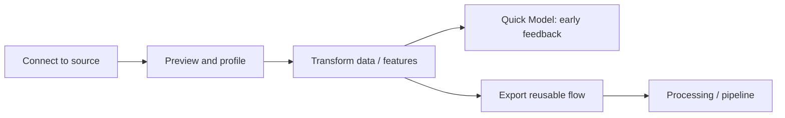
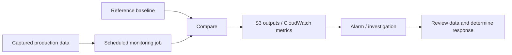
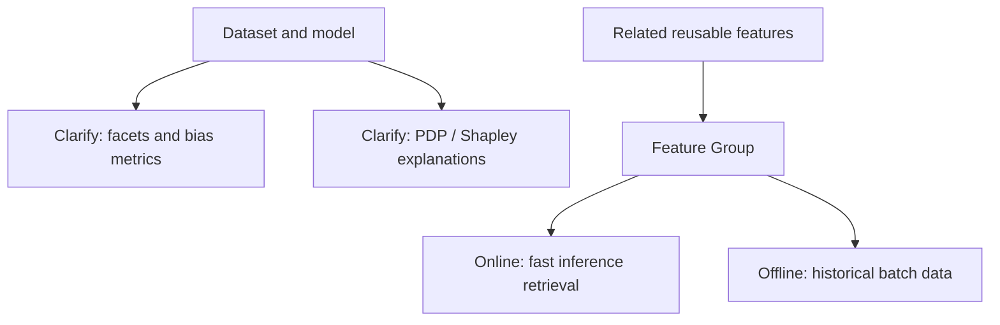

# Conceptual workflow diagrams by presentation

## Part 1 — Data Wrangler

## Part 2 — Model Monitor

## Part 3 — Clarify and Feature Store

Diagrams illustrate presentation concepts only, not any live infrastructure.
